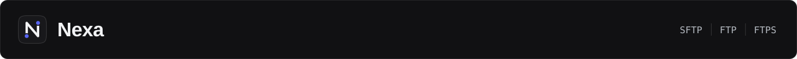

<p align="center">
  <a href="README.de.md"></a>
</p>

<p align="center">
  <a href="CONTRIBUTING.md">English</a> · <a href="CONTRIBUTING.ru.md">Русский</a> · <strong>Deutsch</strong>
</p>

<p align="center"><sub>
  <a href="README.de.md">Überblick</a> ·
  <a href="CHANGELOG.de.md">Änderungsprotokoll</a> ·
  <a href="VERSION.de.md">Version</a> ·
  <strong>Mitwirken</strong> ·
  <a href="SECURITY.de.md">Sicherheit</a> ·
  <a href="CODE_OF_CONDUCT.de.md">Verhaltenskodex</a> ·
  <a href="THIRD_PARTY_NOTICES.de.md">Hinweise zu Drittkomponenten</a>
</sub></p>

#  Mitwirken

Danke, dass Sie Nexa helfen möchten.

## Bevor Sie anfangen

- Suchen Sie Ihr Thema zuerst unter den offenen Issues.
- Melden Sie einen Fehler mit der Vorlage „Bug report“, eine Idee mit der
  Vorlage „Feature request“.
- Ein Pull Request, eine Änderung.

> [!WARNING]
> Veröffentlichen Sie niemals Passwörter, private Schlüssel, echte
> Serveradressen oder Logs mit personenbezogenen Daten: nicht in Issues, nicht in
> Pull Requests, nicht auf Screenshots.

## Bauen

Nexa wird unter Windows in MSYS2 UCRT64 gebaut. Sie brauchen GCC mit C++20,
CMake, Ninja, Qt 6 Base, libssh und pkg-config.

```powershell
cmake -S . -B build -G Ninja -DCMAKE_BUILD_TYPE=Debug -DBUILD_TESTING=ON
cmake --build build --parallel
ctest --test-dir build --output-on-failure
```

## Code

- Schreiben Sie C++20, im Stil der Datei, die Sie bearbeiten.
- Halten Sie das Netzwerk und langsame Dateiarbeit vom UI-Thread fern.
- Schließen Sie SSH-, SFTP- und Systemressourcen mit RAII.
- Halten Sie Geheimnisse, Pfade von Ihrem Rechner und Build-Ausgaben aus dem
  Repository heraus.
- Wenn Sie das Verhalten ändern, ergänzen oder korrigieren Sie einen Test.

## Dokumentation

Jedes Dokument hat drei Fassungen: `NAME.md` auf Englisch, `NAME.ru.md` auf
Russisch und `NAME.de.md` auf Deutsch. Ändern Sie eine, ändern Sie die anderen
im selben Pull Request. Sie haben denselben Aufbau und denselben Inhalt, nur die
Sprache unterscheidet sich.

- Die Texte der Oberfläche stehen im Quellcode auf Russisch, die Übersetzungen
  liegen in `src/ui/i18n_en.cpp` und `src/ui/i18n_de.cpp`. Die Namen der
  Schaltflächen in der Dokumentation müssen dem entsprechen, was Sie in der App
  sehen.
- Die App nimmt ihre Screenshots selbst auf:

  ```powershell
  .\build\Nexa.exe --demo-shots docs\assets --language en
  .\build\Nexa.exe --demo-shots docs\assets\ru --language ru
  .\build\Nexa.exe --demo-shots docs\assets\de --language de
  ```

- Das Banner, die Zahlen und die Symbole in `docs/assets/brand` erzeugt ein
  Skript. Bearbeiten Sie das Skript, nicht die SVG-Dateien:

  ```powershell
  node scripts\brand-assets.mjs
  ```

## Commits

Ein kurzer Satz auf Englisch, im Imperativ:

```text
Fix reconnect when listing a remote directory
Add Explorer virtual-file drag support
```

## Pull Requests

Schreiben Sie in die Beschreibung, was das Problem war, wie Sie es gelöst und
wie Sie es geprüft haben. Hat sich das Aussehen der App geändert, fügen Sie
Screenshots hinzu.

> [!NOTE]
> Indem Sie Code einsenden, stimmen Sie zu, dass er unter der Lizenz
> GPL-3.0-or-later verbreitet wird.
