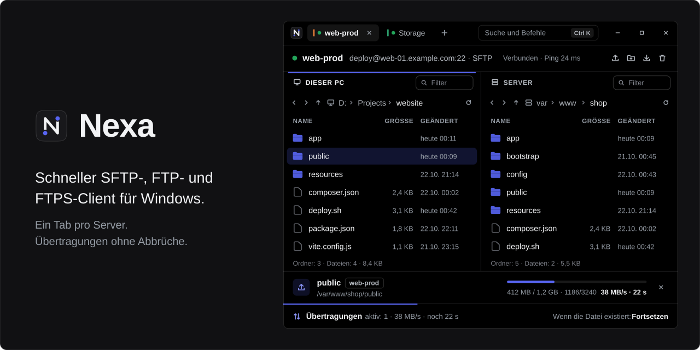
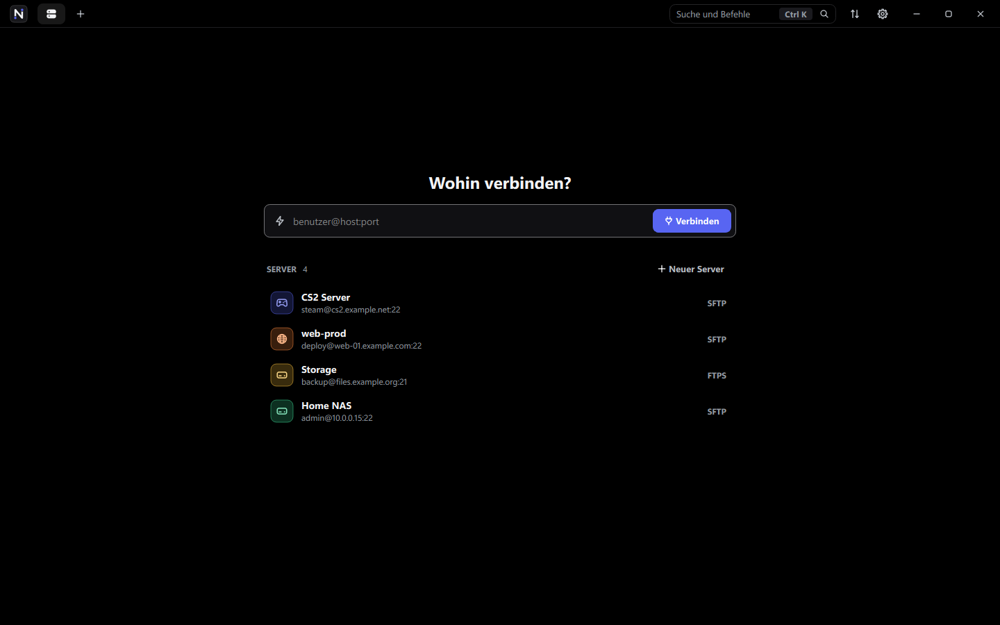
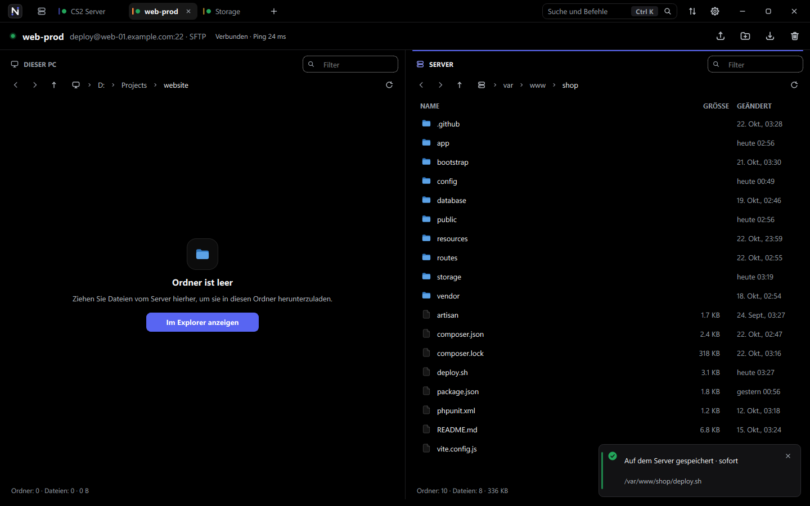
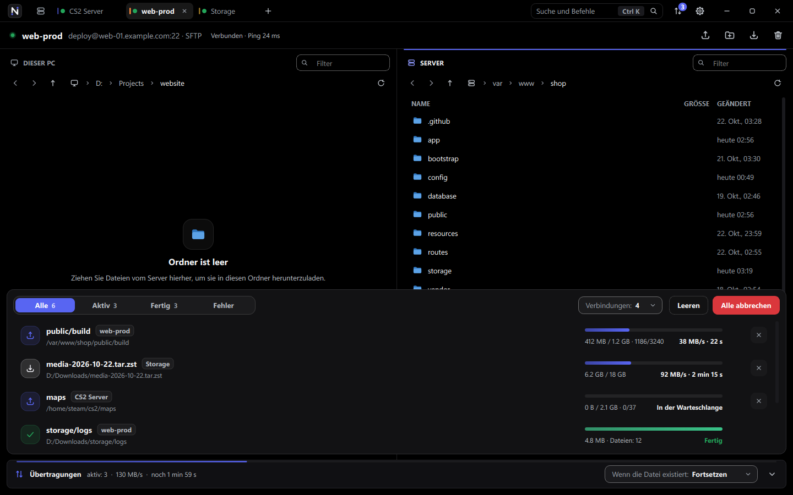
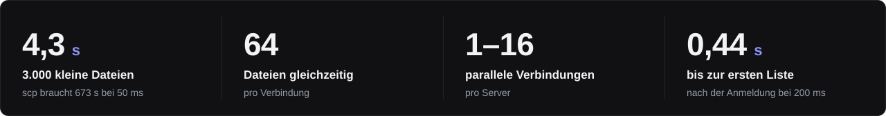

<p align="center">
  
</p>

<p align="center">
  <a href="README.md">English</a> · <a href="README.ru.md">Русский</a> · <strong>Deutsch</strong>
</p>

<p align="center">
  <a href="https://github.com/whyn0tq/Nexa/releases/latest"></a>
  
  
</p>


**Nexa ist ein schneller SFTP-, FTP- und FTPS-Client für Windows.** Jeder Server
öffnet sich in einem eigenen Tab. Dateien laufen über mehrere Verbindungen
gleichzeitig, und bricht die Verbindung ab, verbindet sich Nexa neu und
überträgt die Datei von selbst zu Ende.

- **Schnell.** 3.000 kleine Dateien sind in 4 Sekunden hochgeladen. `scp`
  braucht auf derselben Leitung 11 Minuten.
- **Viele Server.** Ein Tab, ein Server.
- **Keine Abbrüche.** Reißt die Verbindung ab, verbindet sich Nexa neu, und die
  Datei läuft dort weiter, wo sie stehen geblieben ist.
- **Drag & Drop.** Ziehen Sie Dateien aus dem Explorer, sogar aus einem ZIP,
  direkt ins Fenster.
- **Sicher.** Windows verschlüsselt Ihre Passwörter (DPAPI). Hostschlüssel und
  Zertifikate werden anhand ihres SHA-256-Fingerabdrucks geprüft.

## Installation

1. Laden Sie `Nexa-<Version>-windows-x64.zip` von der
   [Release-Seite](https://github.com/whyn0tq/Nexa/releases/latest) herunter.
2. Entpacken Sie das Archiv und starten Sie `Nexa.exe`. Eine Installation ist
   nicht nötig.

## So funktioniert es



Geben Sie eine Adresse in die Schnellverbindung ein (`Strg` + `T`) oder klicken
Sie auf einen gespeicherten Server. Jede dieser Formen funktioniert:

```text
deploy@example.com:22
sftp://deploy@example.com
ftp://user@files.example.org:21
```

Um einen Server zu speichern, drücken Sie `Strg` + `N`. Dort wählen Sie auch das
Protokoll: SFTP, FTP oder FTPS.



Links ist Ihr Computer, rechts der Server. Ziehen Sie Dateien ins Fenster, und
sie werden in den geöffneten Ordner auf dem Server hochgeladen. `F4` öffnet eine
Serverdatei in Ihrem Editor: Jedes Speichern geht direkt zurück.



Alle Übertragungen liegen in der Leiste unten (`Strg` + `J`). Gibt es schon eine
Datei mit demselben Namen, folgt Nexa der gewählten Regel:

| Regel | Was passiert |
|---|---|
| **Fortsetzen** | Eine unfertige Datei läuft weiter, eine fertige wird übersprungen |
| **Ersetzen** | Die Datei wird immer überschrieben |
| **Überspringen** | Vorhandene Dateien bleiben unberührt |
| **Umbenennen** | Die neue Datei bekommt einen anderen Namen, die alte bleibt |

Die Oberfläche gibt es auf Englisch, Russisch und Deutsch. Die Sprache wählen
Sie in den Einstellungen (`Strg` + `,`) oder beim Start:

```powershell
Nexa.exe --language de
```

## Tastenkürzel

| Tasten | Aktion |
|---|---|
| `Strg` + `K` | Suche und Befehle |
| `Strg` + `T` | Schnellverbindung |
| `Strg` + `N` | Neuer Server |
| `Strg` + `W` | Tab schließen |
| `Strg` + `Tab` | Nächster Tab |
| `Strg` + `J` | Übertragungen ein- oder ausblenden |
| `Strg` + `,` | Einstellungen |
| `Strg` + `U` / `Strg` + `D` | Auswahl hochladen / herunterladen |
| `Strg` + `Umschalt` + `N` | Neuer Ordner auf dem Server |
| `F2` / `Entf` | Umbenennen / löschen |
| `F4` | Serverdatei im Editor öffnen |
| `F5` | Aktualisieren |
| `Strg` + `L` / `Strg` + `F` | Pfad eingeben / nach Namen filtern |
| `Alt` + `←` / `→` | Zurück und vorwärts |
| `Rücktaste` | Einen Ordner nach oben |

## Geschwindigkeit



Gemessen unter Windows 11 gegen OpenSSH 9.6 mit 50 ms zusätzlicher Latenz:

| Was wir hochladen | `scp` | Nexa, 1 Verbindung | Nexa, 4 Verbindungen |
|---|---:|---:|---:|
| 3.000 kleine Dateien (14 MB) | 673 s | 9,4 s | **4,3 s** |
| Eine Datei mit 200 MB | 24,7 MB/s | **28,1 MB/s** | 26,3 MB/s |

Die Benchmarks sind `tests/transfer_bench.cpp` und `tests/connect_bench.cpp`.
Jede Übertragung wurde Byte für Byte geprüft, auch eine, bei der die Verbindung
mitten im Hochladen getrennt wurde.

## Aus dem Quellcode bauen

Sie brauchen Windows 10 oder 11 x64, CMake 3.24+, Ninja, einen C++20-Compiler,
Qt 6.6+, libssh 0.12+ und pkg-config. Am einfachsten geht es mit MSYS2 UCRT64.

```powershell
cmake -S . -B build -G Ninja -DCMAKE_BUILD_TYPE=Release -DBUILD_TESTING=ON
cmake --build build --parallel
ctest --test-dir build --output-on-failure
.\scripts\build.ps1 -OutputDirectory dist-release
.\scripts\package.ps1 -Zip
```

Das Archiv landet in `dist\`. Es läuft auf jedem Rechner mit Windows 10 oder 11
ohne MSYS2. Wer einen `v*`-Tag pusht, löst dasselbe in GitHub Actions aus und
bekommt einen Release-Entwurf.

## Roadmap

- [x] Mehrere Server in Tabs
- [x] Parallele Übertragungen und Fortsetzen
- [x] Serverdateien öffnen und bearbeiten
- [ ] SSH-Terminal in einem Tab
- [ ] Eine Übertragungswarteschlange, die einen Neustart übersteht
- [ ] Portweiterleitung und Jump-Hosts
- [ ] Installationsprogramm und automatische Updates

## Sicherheit und Lizenz

Nexa verbindet sich nur mit den Servern, die Sie hinzufügen, sendet keine
Telemetrie und prüft nichts im Hintergrund. Melden Sie Schwachstellen
vertraulich, wie in [SECURITY.de.md](SECURITY.de.md) beschrieben.

Die Lizenz ist [GPL-3.0 oder neuer](LICENSE). Qt und libssh werden als
Bibliotheken genutzt und behalten ihre eigenen Lizenzen, siehe
[THIRD_PARTY_NOTICES.de.md](THIRD_PARTY_NOTICES.de.md).


<p align="center">
  <br>
  <sub>
    <a href="CHANGELOG.de.md">Änderungsprotokoll</a> ·
    <a href="CONTRIBUTING.de.md">Mitwirken</a> ·
    <a href="CODE_OF_CONDUCT.de.md">Verhaltenskodex</a>
  </sub>
</p>
