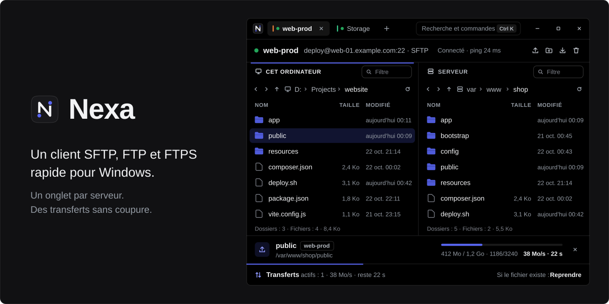
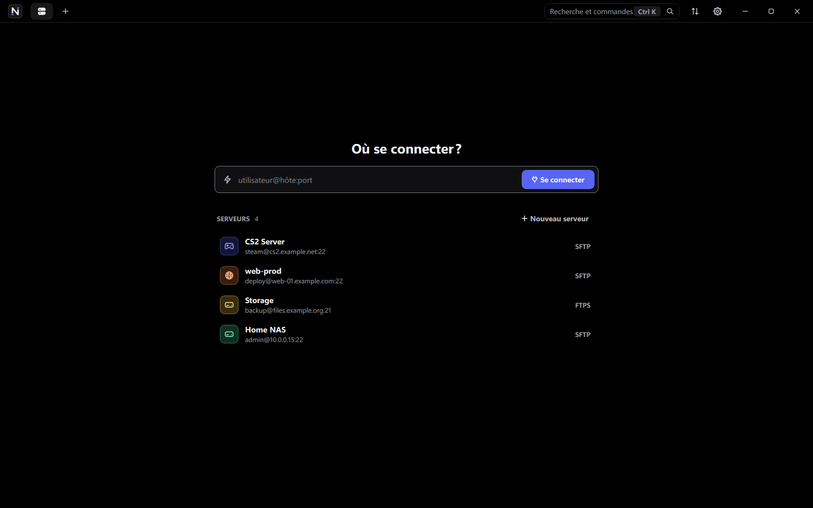
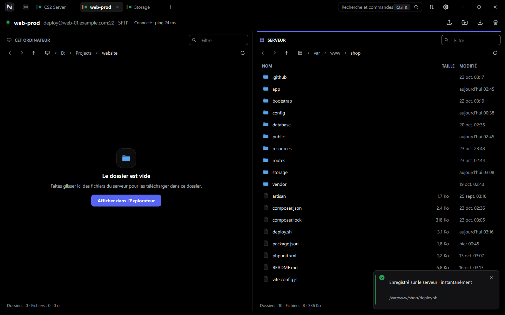
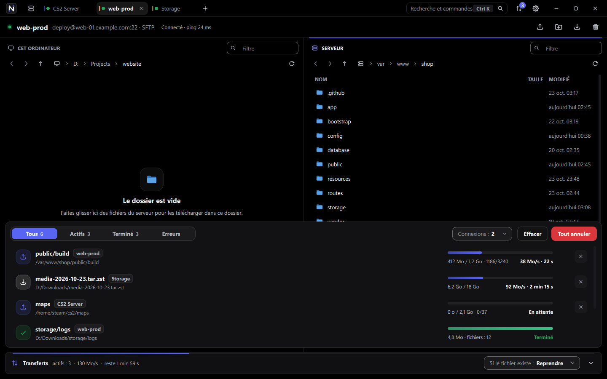
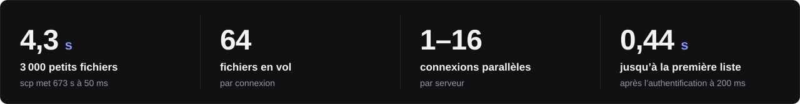

<p align="center">
  
</p>

<p align="center">
  <a href="README.md">English</a> · <a href="README.ru.md">Русский</a> · <a href="README.de.md">Deutsch</a> · <strong>Français</strong>
</p>

<p align="center">
  <a href="https://github.com/whyn0tq/Nexa/releases/latest"></a>
  
  
</p>


**Nexa est un client SFTP, FTP et FTPS rapide pour Windows.** Chaque serveur
s’ouvre dans son propre onglet. Les fichiers passent par plusieurs connexions à
la fois, et si la liaison tombe, Nexa se reconnecte et termine le fichier tout
seul.

- **Rapide.** 3 000 petits fichiers sont envoyés en 4 secondes. `scp` met
  11 minutes sur la même liaison.
- **Plusieurs serveurs.** Un onglet, un serveur.
- **Sans coupure.** La liaison tombe, Nexa se reconnecte, et le fichier reprend
  là où il s’est arrêté.
- **Glisser-déposer.** Faites glisser des fichiers depuis l’Explorateur, même
  depuis un ZIP, directement dans la fenêtre.
- **Sûr.** Windows chiffre vos mots de passe (DPAPI). Les clés d’hôte et les
  certificats sont vérifiés par leur empreinte SHA-256.

## Installation

Choisissez sur la [page des versions](https://github.com/whyn0tq/Nexa/releases/latest) :

- **Installation :** lancez `Nexa-<version>-windows-x64-setup.exe`. Choisissez le
  dossier et, si souhaité, un raccourci sur le bureau. Par défaut : `C:\Program Files\Nexa`.
  L’installation pour tous les utilisateurs nécessite les droits administrateur.
- **Portable :** décompressez `Nexa-<version>-windows-x64.zip` et lancez `Nexa.exe`.

Le programme ajoute Nexa au menu Démarrer et à la liste des applications Windows.
La désinstallation supprime le dossier d’installation, les paramètres, les
serveurs enregistrés, le cache et les fichiers temporaires de Nexa.

## Utilisation



Saisissez une adresse dans la connexion rapide (`Ctrl` + `T`) ou cliquez sur un
serveur enregistré. Toutes ces formes fonctionnent :

```text
deploy@example.com:22
sftp://deploy@example.com
ftp://user@files.example.org:21
```

Pour enregistrer un serveur, appuyez sur `Ctrl` + `N`. C’est aussi là que vous
choisissez le protocole : SFTP, FTP ou FTPS.



Votre ordinateur est à gauche, le serveur à droite. Déposez des fichiers dans la
fenêtre, et ils sont envoyés dans le dossier ouvert sur le serveur. `F4` ouvre
un fichier du serveur dans votre éditeur : chaque enregistrement repart
aussitôt sur le serveur.



Tous les transferts se trouvent dans le panneau du bas (`Ctrl` + `J`). Si un
fichier du même nom existe déjà, Nexa suit la règle que vous avez choisie :

| Règle | Ce qui se passe |
|---|---|
| **Reprendre** | Un fichier inachevé reprend, un fichier complet est ignoré |
| **Remplacer** | Le fichier est toujours écrasé |
| **Ignorer** | Les fichiers existants ne sont pas modifiés |
| **Renommer** | Le nouveau fichier reçoit un autre nom, l’ancien est conservé |

L’interface existe en anglais, en russe, en allemand et en français. Choisissez
la langue dans les Paramètres (`Ctrl` + `,`) ou au lancement :

```powershell
Nexa.exe --language fr
```

## Raccourcis clavier

| Touches | Action |
|---|---|
| `Ctrl` + `K` | Recherche et commandes |
| `Ctrl` + `T` | Connexion rapide |
| `Ctrl` + `N` | Nouveau serveur |
| `Ctrl` + `W` | Fermer l’onglet |
| `Ctrl` + `Tab` | Onglet suivant |
| `Ctrl` + `J` | Afficher ou masquer les transferts |
| `Ctrl` + `,` | Paramètres |
| `Ctrl` + `U` / `Ctrl` + `D` | Envoyer / télécharger la sélection |
| `Ctrl` + `Maj` + `N` | Nouveau dossier sur le serveur |
| `F2` / `Suppr` | Renommer / supprimer |
| `F4` | Ouvrir un fichier du serveur dans votre éditeur |
| `F5` | Actualiser |
| `Ctrl` + `L` / `Ctrl` + `F` | Saisir un chemin / filtrer par nom |
| `Alt` + `←` / `→` | Précédent et suivant |
| `Retour arrière` | Remonter d’un dossier |

## Vitesse



Mesuré sous Windows 11 face à OpenSSH 9.6, avec 50 ms de latence ajoutée :

| Ce que nous envoyons | `scp` | Nexa, 1 connexion | Nexa, 4 connexions |
|---|---:|---:|---:|
| 3 000 petits fichiers (14 Mo) | 673 s | 9,4 s | **4,3 s** |
| Un fichier de 200 Mo | 24,7 Mo/s | **28,1 Mo/s** | 26,3 Mo/s |

Les bancs d’essai sont `tests/transfer_bench.cpp` et `tests/connect_bench.cpp`.
Chaque transfert a été vérifié octet par octet, y compris un transfert pendant
lequel la liaison a été coupée en plein envoi.

## Compiler depuis les sources

Il vous faut Windows 10 ou 11 x64, CMake 3.24+, Ninja, un compilateur C++20,
Qt 6.6+, libssh 0.12+ et pkg-config. Le plus simple est MSYS2 UCRT64.

```powershell
cmake -S . -B build -G Ninja -DCMAKE_BUILD_TYPE=Release -DBUILD_TESTING=ON
cmake --build build --parallel
ctest --test-dir build --output-on-failure
.\scripts\build.ps1 -OutputDirectory dist-release
.\scripts\package.ps1 -Zip
```

Pour les deux formats, utilisez Inno Setup 6.3 ou ultérieur et PowerShell 7 :

```powershell
.\scripts\package.ps1 -Zip -Installer -Compiler "C:\Program Files (x86)\Inno Setup 6\ISCC.exe"
.\scripts\test-package.ps1 -Compiler "C:\Program Files (x86)\Inno Setup 6\ISCC.exe"
```

Les tests installent, mettent à jour, lancent et désinstallent une copie temporaire.
L’enregistrement, les raccourcis, les paramètres et les dossiers de données sont isolés.
Avec `-AllUsers` dans un PowerShell administrateur, le test couvre l’installation
pour tous les utilisateurs ; sinon, il utilise le compte courant.

L’archive arrive dans `dist\`. Elle fonctionne sur n’importe quelle machine sous
Windows 10 ou 11, sans MSYS2. Pousser un tag `v*` fait la même chose dans GitHub
Actions et prépare un brouillon de version.

## Feuille de route

- [x] Plusieurs serveurs dans des onglets
- [x] Transferts parallèles et reprise
- [x] Ouvrir et modifier les fichiers du serveur
- [ ] Terminal SSH dans un onglet
- [ ] Une file de transferts qui survit à un redémarrage
- [ ] Redirection de ports et hôtes de rebond
- [x] Programme d’installation pour Windows
- [ ] Mise à jour automatique

## Sécurité et licence

Nexa se connecte uniquement aux serveurs que vous ajoutez, n’envoie aucune
télémétrie et ne vérifie rien en arrière-plan. Signalez les vulnérabilités en
privé, comme décrit dans [SECURITY.fr.md](SECURITY.fr.md).

La licence est la [GPL-3.0 ou ultérieure](LICENSE). Qt et libssh sont utilisées
comme bibliothèques et conservent leurs propres licences, voir
[THIRD_PARTY_NOTICES.fr.md](THIRD_PARTY_NOTICES.fr.md).


<p align="center">
  <br>
  <sub>
    <a href="CHANGELOG.fr.md">Journal des modifications</a> ·
    <a href="CONTRIBUTING.fr.md">Contribuer</a> ·
    <a href="CODE_OF_CONDUCT.fr.md">Code de conduite</a>
  </sub>
</p>
