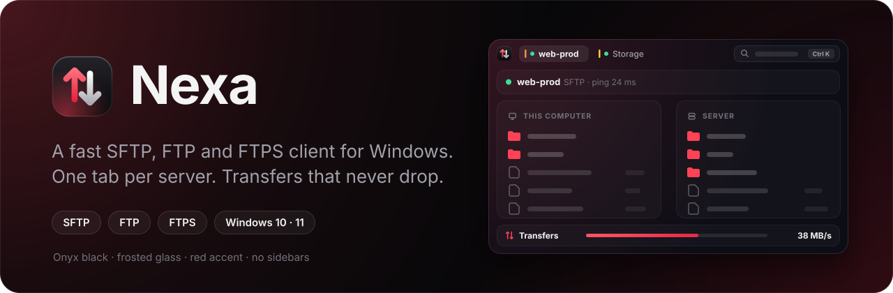
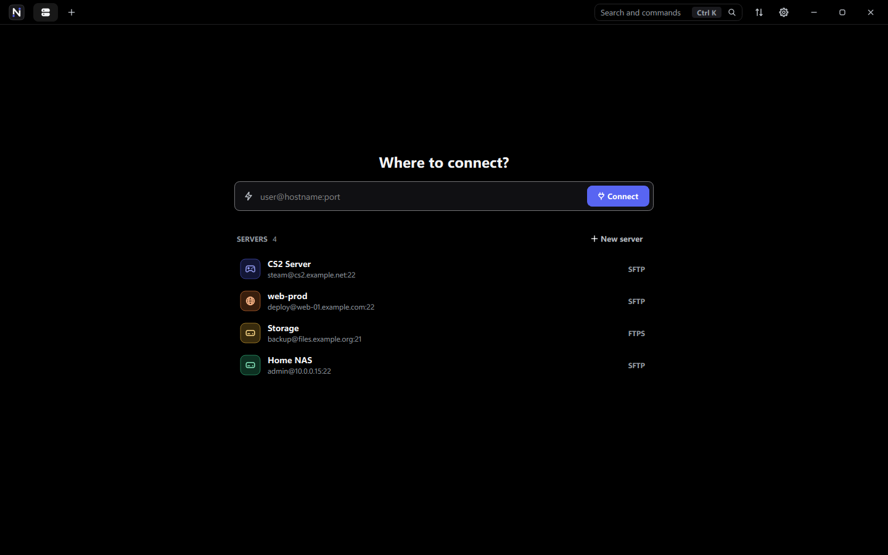
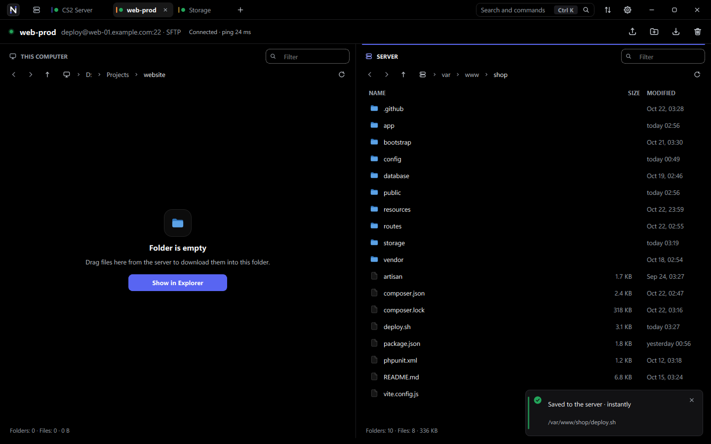
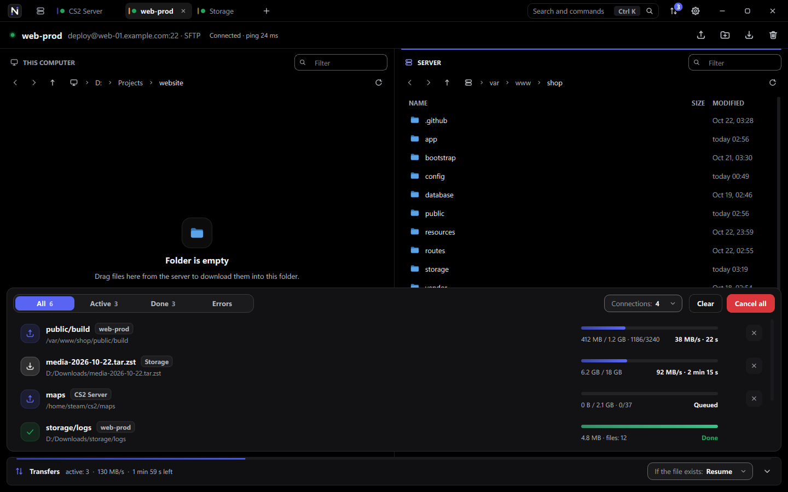
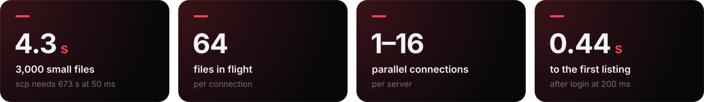

<p align="center">
  
</p>

<p align="center">
  <strong>English</strong> · <a href="README.ru.md">Русский</a> · <a href="README.de.md">Deutsch</a>
</p>

<p align="center">
  <a href="https://github.com/whyn0tq/Nexa/releases/latest"></a>
  
  
</p>


**Nexa is a fast SFTP, FTP and FTPS client for Windows.** Every server opens in
its own tab. Files go over several connections at once, and if the link drops,
Nexa reconnects and finishes the file on its own.

- **Fast.** 3,000 small files go up in 4 seconds. `scp` on the same link takes
  11 minutes.
- **Many servers.** One tab, one server.
- **No drops.** The link breaks, Nexa reconnects, and the file carries on from
  where it stopped.
- **Drag and drop.** Drag files from Explorer, even out of a ZIP, straight into
  the window.
- **Safe.** Windows encrypts your passwords (DPAPI). Host keys and certificates
  are checked by their SHA-256 fingerprint.

## Install

1. Download `Nexa-<version>-windows-x64.zip` from the
   [releases page](https://github.com/whyn0tq/Nexa/releases/latest).
2. Unzip it and run `Nexa.exe`. Nothing to install.

## How to use it



Type an address into quick connect (`Ctrl` + `T`) or click a saved server. Any of
these works:

```text
deploy@example.com:22
sftp://deploy@example.com
ftp://user@files.example.org:21
```

To save a server, press `Ctrl` + `N`. That is also where you pick the protocol:
SFTP, FTP or FTPS.



Your computer is on the left, the server on the right. Drop files into the
window and they upload to the open server folder. `F4` opens a server file in
your editor: every save goes straight back.



All transfers live in the dock at the bottom (`Ctrl` + `J`). If a file with the
same name already exists, Nexa follows the rule you picked:

| Rule | What happens |
|---|---|
| **Resume** | An unfinished file carries on, a finished one is skipped |
| **Replace** | The file is always overwritten |
| **Skip** | Existing files are left alone |
| **Rename** | The new file gets another name, the old one stays |

The interface is in English, Russian and German. Pick the language in Settings
(`Ctrl` + `,`) or at launch:

```powershell
Nexa.exe --language en
```

## Keyboard shortcuts

| Keys | Action |
|---|---|
| `Ctrl` + `K` | Search and commands |
| `Ctrl` + `T` | Quick connect |
| `Ctrl` + `N` | New server |
| `Ctrl` + `W` | Close tab |
| `Ctrl` + `Tab` | Next tab |
| `Ctrl` + `J` | Show or hide transfers |
| `Ctrl` + `,` | Settings |
| `Ctrl` + `U` / `Ctrl` + `D` | Upload / download the selection |
| `Ctrl` + `Shift` + `N` | New folder on the server |
| `F2` / `Delete` | Rename / delete |
| `F4` | Open a server file in your editor |
| `F5` | Refresh |
| `Ctrl` + `L` / `Ctrl` + `F` | Type a path / filter by name |
| `Alt` + `←` / `→` | Back and forward |
| `Backspace` | Up one folder |

## Speed



Measured on Windows 11 against OpenSSH 9.6 with 50 ms of added latency:

| What we upload | `scp` | Nexa, 1 connection | Nexa, 4 connections |
|---|---:|---:|---:|
| 3,000 small files (14 MB) | 673 s | 9.4 s | **4.3 s** |
| One 200 MB file | 24.7 MB/s | **28.1 MB/s** | 26.3 MB/s |

The benchmarks are `tests/transfer_bench.cpp` and `tests/connect_bench.cpp`.
Every transfer was checked byte by byte, including one where the link was cut in
the middle of an upload.

## Build from source

You need Windows 10 or 11 x64, CMake 3.24+, Ninja, a C++20 compiler, Qt 6.6+,
libssh 0.12+ and pkg-config. The easiest way is MSYS2 UCRT64.

```powershell
cmake -S . -B build -G Ninja -DCMAKE_BUILD_TYPE=Release -DBUILD_TESTING=ON
cmake --build build --parallel
ctest --test-dir build --output-on-failure
.\scripts\build.ps1 -OutputDirectory dist-release
.\scripts\package.ps1 -Zip
```

The archive lands in `dist\`. It runs on any Windows 10 or 11 machine without
MSYS2. Pushing a `v*` tag does the same in GitHub Actions and drafts a release.

## Roadmap

- [x] Several servers in tabs
- [x] Parallel transfers and resume
- [x] Open and edit server files
- [ ] SSH terminal in a tab
- [ ] A transfer queue that survives a restart
- [ ] Port forwarding and jump hosts
- [ ] Installer and auto-update

## Security and license

Nexa connects only to the servers you add, sends no telemetry and checks for
nothing in the background. Report vulnerabilities privately, as described in
[SECURITY.md](SECURITY.md).

The license is [GPL-3.0 or later](LICENSE). Qt and libssh are used as libraries
and keep their own licenses, see [THIRD_PARTY_NOTICES.md](THIRD_PARTY_NOTICES.md).


<p align="center">
  <br>
  <sub>
    <a href="CHANGELOG.md">Changelog</a> ·
    <a href="CONTRIBUTING.md">Contributing</a> ·
    <a href="CODE_OF_CONDUCT.md">Code of Conduct</a>
  </sub>
</p>
