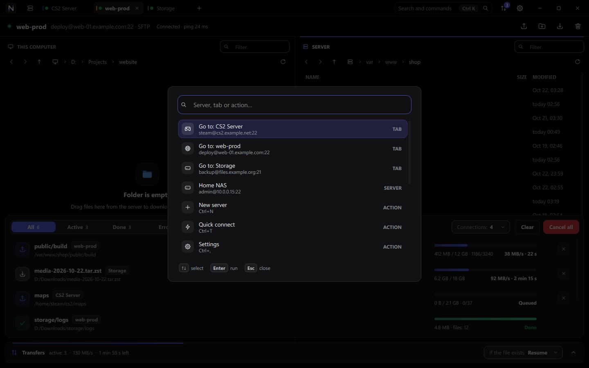
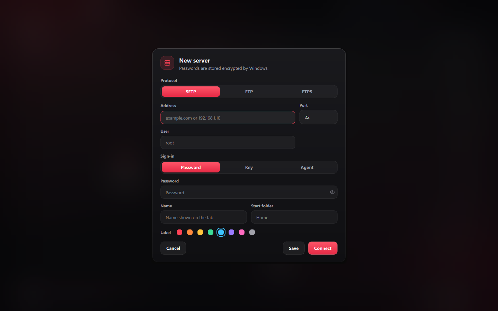
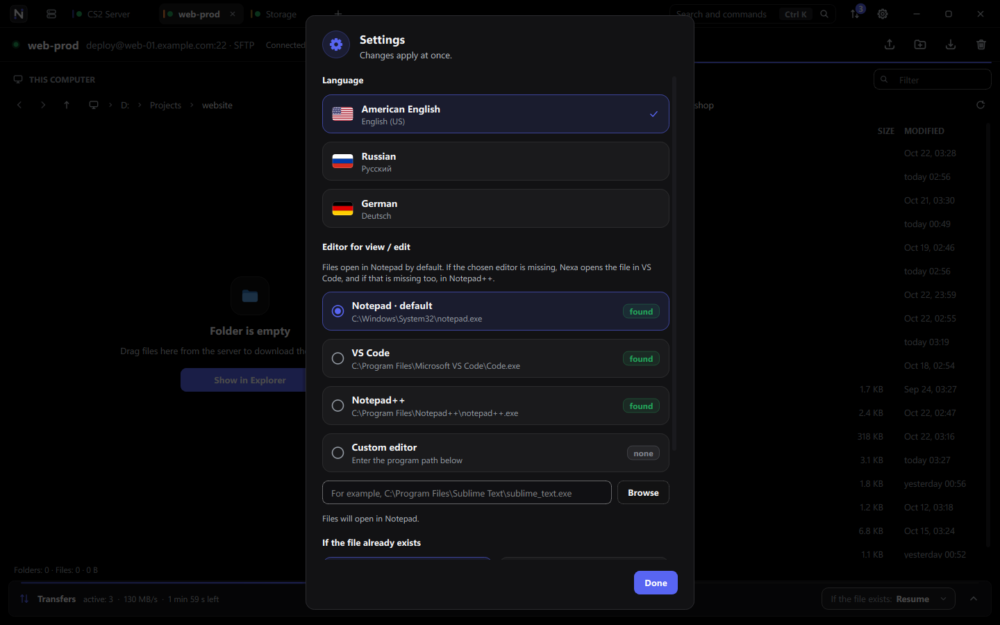

<p align="center">
  
</p>

<p align="center">
  <strong>English</strong> · <a href="README.ru.md">Русский</a>
</p>

<p align="center">
  <a href="https://github.com/whyn0tq/Nexa/releases/latest"></a>
  
  
  
  
</p>

<p align="center">
  <a href="#tour">Tour</a> ·
  <a href="#performance">Performance</a> ·
  <a href="#features">Features</a> ·
  <a href="#shortcuts">Shortcuts</a> ·
  <a href="#build">Build</a> ·
  <a href="#roadmap">Roadmap</a>
</p>


**Nexa is a fast SFTP, FTP and FTPS client for Windows.** Every server opens in
its own tab, transfers run over several parallel connections, and a dropped link
is picked up again on its own. Onyx black, frosted glass, a red accent — and no
sidebars.

<table>
  <tr>
    <td width="50%" valign="top">
      <br>
      <strong>Fast on real links</strong><br>
      Up to 64 files in flight per connection, 1–16 connections per server.
      3,000 small files go up in 4 seconds, not 11 minutes.
    </td>
    <td width="50%" valign="top">
      <br>
      <strong>Many servers at once</strong><br>
      One tab per server, each with its own browsing and transfer connections.
    </td>
  </tr>
  <tr>
    <td width="50%" valign="top">
      <br>
      <strong>Never drops</strong><br>
      Idle sessions are pinged, broken links reconnect forever, and interrupted
      files continue from the byte they reached.
    </td>
    <td width="50%" valign="top">
      <br>
      <strong>Drop anywhere</strong><br>
      Drag files from Explorer — even straight out of a ZIP — anywhere into the
      window.
    </td>
  </tr>
  <tr>
    <td width="50%" valign="top">
      <br>
      <strong>Instant</strong><br>
      A tab shows its folder the moment it opens; subfolders and small files are
      fetched ahead, so opening them does not wait for the network.
    </td>
    <td width="50%" valign="top">
      <br>
      <strong>Safe by default</strong><br>
      Passwords are encrypted with Windows DPAPI; host keys and TLS certificates
      are checked by their SHA-256 fingerprint.
    </td>
  </tr>
</table>

<a name="tour"></a>

##  A quick tour

> [!NOTE]
> The screenshots show made-up servers and an empty local folder. The app takes
> them itself with `Nexa.exe --demo-shots <folder>`, using an offline fake
> server and a throwaway settings profile.

### Servers


The home page lists saved servers as cards with a color label, the protocol and
when you last connected. Type `user@host:22`, `sftp://…` or `ftp://…` into quick
connect, or open a saved server with one click. Tabs that were open last time
come back by themselves, each in the folder it was left in.

### Two panes, one window


**This computer** on the left, **the server** on the right. Both panes have
breadcrumbs, back and forward, a name filter and sortable columns. The header
shows the server, the protocol and its live ping.

- Drop files anywhere in the window and they upload to the open server folder.
  Drag between the panes, or onto another tab to switch to it.
- <kbd>F4</kbd> opens a server file in your editor (Notepad by default, VS Code
  or Notepad++ as fallbacks). Every save goes straight back to the server, and a
  notification tells you how long it took.
- <kbd>Delete</kbd> and <kbd>F2</kbd> act on the pane that has the focus. Local
  deletes go to the Recycle Bin and disappear from the list at once.

### Transfers


One queue for all servers, in a dock at the bottom (<kbd>Ctrl</kbd> + <kbd>J</kbd>).
Each row shows progress, files, speed and time left, with retry and cancel. Big
files are split into segments that move over several connections at once.

What happens to files that **already exist** is always in sight: the bar at the
bottom shows the current rule, and the open dock has the four choices with a
plain explanation of the selected one.

| Rule | What it does |
|---|---|
| **Resume** | An interrupted file continues where it stopped; a complete one is skipped |
| **Replace** | A file with the same name is always overwritten |
| **Skip** | Files that already exist are left alone |
| **Rename** | The new file is saved under another name; the old one stays |

### Command palette



<kbd>Ctrl</kbd> + <kbd>K</kbd> finds any server, tab or action by a few letters.

### Adding a server



SFTP, FTP or FTPS; password, private key or SSH agent; a name, a start folder and
a color label. Passwords are encrypted with Windows DPAPI. Host keys and TLS
certificates are checked by their SHA-256 fingerprint.

### Settings



<kbd>Ctrl</kbd> + <kbd>,</kbd> sets the interface language, the editor for view /
edit, the rule for existing files and the number of parallel connections per
server.

> [!TIP]
> Nexa speaks **American English** by default, and **Russian** or **German** on
> request: pick the flag in Settings and confirm the restart — open tabs come
> back by themselves. `Nexa.exe --language ru` (or `de`, `en`) does the same from
> the command line.

<a name="performance"></a>

##  Performance


Measured on Windows 11 against OpenSSH 9.6 with added latency (`tc netem`),
using `tests/transfer_bench.cpp` and `tests/connect_bench.cpp`. At 50 ms round
trip:

| Workload | OpenSSH `scp` | Nexa, 1 connection | Nexa, 4 connections |
|---|---:|---:|---:|
| Upload 3,000 small files (14 MB) | 673 s · 4 files/s | 9.4 s · 321 files/s | **4.3 s · 696 files/s** |
| Upload one 200 MB file | 24.7 MB/s | **28.1 MB/s** | 26.3 MB/s |

At 200 ms round trip, the first folder listing arrives 0.44 s after login. A
saved server shows the folder it was left in immediately, while it is still
connecting.

Every transfer run was checked byte for byte, including one where the connection
was killed in the middle of a 200 MB upload and Nexa resumed it on its own.

<a name="features"></a>

##  Features

<table>
  <tr>
    <td width="50%" valign="top">
      
      <strong>Sessions</strong>
      <ul>
        <li>SFTP over SSH, FTP and FTPS (explicit <code>AUTH TLS</code>) side by side in tabs</li>
        <li>Password, private key, SSH agent and keyboard-interactive login</li>
        <li>Reconnects forever once a server has been reached; transfers wait for the link instead of failing</li>
        <li>Live ping for every session</li>
      </ul>
    </td>
    <td width="50%" valign="top">
      
      <strong>Files</strong>
      <ul>
        <li>Own pipelined SFTP client: listings, deletes and folder creation go out in batches, not one request at a time</li>
        <li>Subfolders are listed ahead, so opening them is instant</li>
        <li>Small files are fetched as soon as they are selected, so view / edit opens them without a network wait</li>
        <li>Drag from Explorer, from ZIP archives in Explorer, between panes and onto tabs</li>
        <li>The local folder is watched and refreshed by itself</li>
      </ul>
    </td>
  </tr>
  <tr>
    <td width="50%" valign="top">
      
      <strong>Transfers</strong>
      <ul>
        <li>1–16 parallel connections per server; big files split into segments</li>
        <li>Resume, replace, skip or rename when the target exists</li>
        <li>Downloads land in a <code>.nexapart</code> file and are renamed only when complete</li>
        <li>One transfer connection is opened ahead of time, so the first transfer starts without a login</li>
      </ul>
    </td>
    <td width="50%" valign="top">
      
      <strong>Interface</strong>
      <ul>
        <li>Own title bar with Windows 11 rounded corners, Snap layouts and resizing</li>
        <li>Frosted glass menus, sheets and notifications over a blurred backdrop</li>
        <li>Animations at the monitor's real refresh rate (144 Hz included)</li>
        <li>English (US), Russian and German, switched in Settings</li>
      </ul>
    </td>
  </tr>
</table>

<a name="shortcuts"></a>

##  Keyboard shortcuts

| Shortcut | Action |
|---|---|
| <kbd>Ctrl</kbd> + <kbd>K</kbd> | Command palette |
| <kbd>Ctrl</kbd> + <kbd>T</kbd> | Quick connect |
| <kbd>Ctrl</kbd> + <kbd>N</kbd> | New server |
| <kbd>Ctrl</kbd> + <kbd>W</kbd> | Close tab |
| <kbd>Ctrl</kbd> + <kbd>Tab</kbd> | Next tab |
| <kbd>Ctrl</kbd> + <kbd>J</kbd> | Show or hide transfers |
| <kbd>Ctrl</kbd> + <kbd>,</kbd> | Settings |
| <kbd>Ctrl</kbd> + <kbd>U</kbd> / <kbd>Ctrl</kbd> + <kbd>D</kbd> | Upload files / download selection |
| <kbd>Ctrl</kbd> + <kbd>Shift</kbd> + <kbd>N</kbd> | New remote folder |
| <kbd>F2</kbd> / <kbd>Delete</kbd> | Rename / delete in the focused pane (local: to the Recycle Bin) |
| <kbd>F4</kbd> | View / edit a server file |
| <kbd>F5</kbd> | Refresh |
| <kbd>Ctrl</kbd> + <kbd>L</kbd> / <kbd>Ctrl</kbd> + <kbd>F</kbd> | Type a path / filter by name |
| <kbd>Alt</kbd> + <kbd>←</kbd> / <kbd>→</kbd> | Back and forward |
| <kbd>Backspace</kbd> | Parent folder |

<a name="build"></a>

##  Build from source

Requirements: Windows 10 or 11 x64, CMake 3.24+, Ninja, a C++20 compiler,
Qt 6.6+ (`Core`, `Gui`, `Widgets`, `Network`), libssh 0.12+ and pkg-config.
MSYS2 UCRT64 is the recommended environment.

```powershell
cmake -S . -B build -G Ninja -DCMAKE_BUILD_TYPE=Release -DBUILD_TESTING=ON
cmake --build build --parallel
ctest --test-dir build --output-on-failure
.\scripts\build.ps1 -OutputDirectory dist-release
.\scripts\package.ps1 -Zip
```

`dist-release` is a portable folder: it runs on any Windows 10 or 11 x64 machine
without MSYS2. `package.ps1` adds the license texts of every shipped library and
packs `dist\Nexa-<version>-windows-x64.zip`. Pushing a `v*` tag does the same in
GitHub Actions and drafts the release with the archive and its SHA-256.

<details>
<summary><strong>Regenerating the screenshots and artwork</strong></summary>

<br>

Screenshots — English for this file, Russian for [README.ru.md](README.ru.md):

```powershell
.\build\Nexa.exe --demo-shots docs\assets
```

```powershell
.\build\Nexa.exe --demo-shots docs\assets\ru --language ru
```

The banner, the numbers, the section icons and the document headers in
`docs/assets/brand` are drawn from the app's own theme colors and icon shapes
(`src/ui/theme.h`, `src/ui/icons.cpp`). Regenerate them after changing the
texts in the script:

```powershell
node scripts\brand-assets.mjs
```

</details>

<details>
<summary><strong>Project structure</strong></summary>

<br>

```text
src/core   protocols (own pipelined SFTP client, FTP/FTPS), sessions,
           transfer engine, saved servers, listing cache
src/ui     window, tabs, panes, transfer dock, sheets, icons, theme and the
           screenshot demo
tests      unit tests, transfer and connect benchmarks
docs       screenshots and README artwork, English and Russian
scripts    portable packaging and artwork generation
```

</details>

<a name="roadmap"></a>

##  Roadmap

- [x] Several servers at once in tabs
- [x] Parallel and segmented transfers
- [x] Automatic reconnection and resume
- [x] View / edit with automatic upload
- [ ] SSH terminal in a tab
- [ ] Queue that survives a restart
- [ ] Port forwarding and jump hosts
- [ ] Windows installer and automatic updates

What changed and when: [CHANGELOG.md](CHANGELOG.md) · [VERSION.md](VERSION.md).

##  Security

> [!WARNING]
> Do not post credentials, private keys, host addresses or sensitive logs in
> public issues. Report vulnerabilities privately — see [SECURITY.md](SECURITY.md).

**Privacy.** Nexa connects only to the servers you add, has no telemetry and
checks for nothing in the background. Release archives are built by
[GitHub Actions](.github/workflows/windows.yml) from this repository.

##  License

Nexa is distributed under the
[GNU General Public License v3.0 or later](LICENSE). Qt and libssh are
dynamically linked and remain under their own licenses; see
[THIRD_PARTY_NOTICES.md](THIRD_PARTY_NOTICES.md).


<p align="center">
  <br>
  <sub>
    <a href="CONTRIBUTING.md">Contributing</a> ·
    <a href="CODE_OF_CONDUCT.md">Code of Conduct</a> ·
    <a href="SECURITY.md">Security</a> ·
    <a href="THIRD_PARTY_NOTICES.md">Third-party notices</a>
  </sub>
</p>
