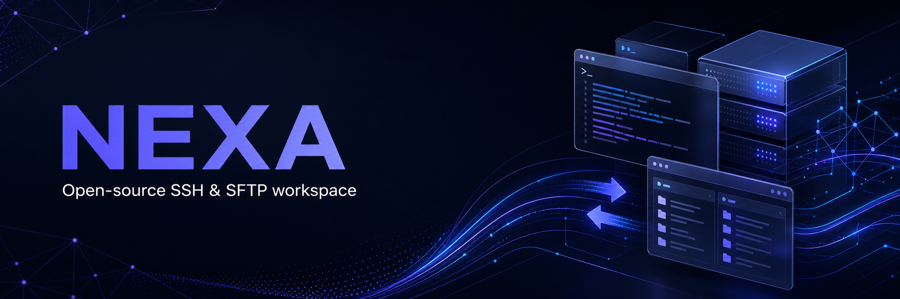

<p align="center">
  
</p>

<p align="center">
  <a href="README.ru.md">Русский</a> · <strong>English</strong>
</p>

<p align="center">
  
  
  
  
  
</p>

# Nexa

Nexa is a modern, local-first SFTP and FTP workspace for Windows. It combines a
two-pane file manager, secure credential storage, a resumable transfer queue and
high-throughput asynchronous transfers in one native desktop application.

> **Preview notice:** Nexa is under active development. Keep independent backups
> when working with important servers.

## Why Nexa?

- **Local-first:** no mandatory account or cloud service.
- **Private:** passwords and passphrases are protected with Windows DPAPI.
- **Never blocked:** transfers run on their own session, so browsing stays
  responsive while gigabytes are moving.
- **Fast:** pipelined directory listing and up to 64 in-flight SFTP requests.
- **Recoverable:** an interrupted transfer continues from the byte it reached.
- **Practical:** drag files, directories and even items from an open ZIP archive.
- **Resilient:** reconnects automatically when a hosting provider drops the
  session.
- **Open:** licensed under GPL-3.0-or-later.

## Features

### Connections and security

- SFTP over SSH and plain FTP in one workspace, chosen per connection profile
- FTPS through explicit `AUTH TLS`, with the data channel protected as well
- Password, private-key, SSH-agent and keyboard-interactive authentication,
  negotiated against the methods the server advertises
- SHA-256 verification of the SSH host key or the TLS certificate
- Detection of changed host keys and certificates
- Encrypted saved credentials using Windows DPAPI
- Session restoration and automatic reconnection
- Restoration of the last remote directory

### File management

- Native two-pane local/remote file browser
- Breadcrumb navigation with back/forward history
- Name filter and sortable columns in both panes
- Upload and download files or complete directory trees
- Create, rename and recursively delete remote entries
- Keyboard shortcuts and context menus
- Directory caching and background prefetch
- Drag and drop in both directions
- Native Windows Explorer `CF_HDROP` support
- Virtual file extraction when dragging directly from ZIP archives

### Transfer engine

- A dedicated session for transfers, so browsing stays responsive while a
  multi-gigabyte transfer runs
- Transfer queue with per-item progress, speed, state and cancellation
- Resumable transfers: an interrupted file continues from the byte it reached,
  through SFTP offsets or the FTP `REST` marker
- Overwrite policies: resume, overwrite, skip or rename
- Downloads land in a `.nexapart` scratch file and are renamed on success, so a
  partial file is never mistaken for a complete one
- Modification time and the executable bit are preserved
- Asynchronous SFTP reads and writes, up to 64 in-flight requests
- Retry after connection loss

### Appearance

- Dark and light themes, remembered between runs (`Ctrl+T`)
- One set of design tokens driving the whole interface
- Inline, dismissible notifications instead of modal error dialogs

## Keyboard shortcuts

| Shortcut | Action |
|---|---|
| `Enter` | Open the selected folder |
| `Delete` | Delete the selected remote entries |
| `F2` | Rename the selected entry |
| `F5` | Refresh the current remote directory |
| `Alt` + `←` / `→` | Back and forward through history |
| `Alt` + `↑` | Go to the parent directory |
| `Ctrl` + `L` | Type a remote path |
| `Ctrl` + `Shift` + `L` | Type a local path |
| `Ctrl` + `F` | Focus the name filter |
| `Ctrl` + `1` / `2` | Switch between Files and Transfers |
| `Ctrl` + `T` | Toggle the dark and light theme |

## Quick start

1. Download the latest portable archive from [GitHub Releases](../../releases).
2. Extract it to a regular directory.
3. Run `Nexa.exe`.
4. Add an SFTP or FTP host and verify the fingerprint it presents.

Do not run Nexa as administrator unless required. Windows can block drag and drop
from a non-elevated Explorer process into an elevated application.

## Build from source

### Requirements

- Windows 10 or 11 x64
- CMake 3.24+
- Ninja
- C++20 compiler
- Qt 6.5+ (`Core`, `Widgets`, `Network`)
- libssh 0.12+
- pkg-config

MSYS2 UCRT64 is the recommended environment.

```powershell
cmake -S . -B build -G Ninja -DCMAKE_BUILD_TYPE=Release -DBUILD_TESTING=ON
cmake --build build --parallel
ctest --test-dir build --output-on-failure
```

Create a portable Windows directory:

```powershell
.\scripts\build.ps1 -OutputDirectory dist-release
```

The result is written to `dist-release\Nexa.exe`.

## Project structure

```text
.
├── .github/           GitHub workflows and templates
├── docs/              Documentation and media
├── scripts/           Build and packaging scripts
├── src/               Application source code
├── tests/             Automated tests
├── CMakeLists.txt
├── README.md
└── VERSION.md
```

## Roadmap

- [x] Transfer queue with per-item progress and cancellation
- [x] Resume and partial-transfer recovery
- [x] FTP and FTPS connections
- [ ] Queue that survives a restart
- [ ] Multiple simultaneous file transfers
- [ ] SSH terminal with tabs
- [ ] Host groups, tags and search
- [ ] Port forwarding and jump hosts
- [ ] Snippets and automation
- [ ] Encrypted user-controlled synchronization
- [ ] Windows installer and automatic updates
- [ ] Linux and macOS support

See [CHANGELOG.md](CHANGELOG.md) for the release history and
[VERSION.md](VERSION.md) for what the current release contains.

## Contributing

Contributions are welcome. Please read [CONTRIBUTING.md](CONTRIBUTING.md) before
opening a pull request. For bugs and feature requests, use the repository issue
templates.

## Security

Do not post credentials, private keys, host addresses or sensitive logs in public
issues. See [SECURITY.md](SECURITY.md) for responsible reporting instructions.

## License

Nexa is distributed under the
[GNU General Public License v3.0 or later](LICENSE).

Qt and libssh are dynamically linked and remain covered by their respective
licenses. See [THIRD_PARTY_NOTICES.md](THIRD_PARTY_NOTICES.md).
