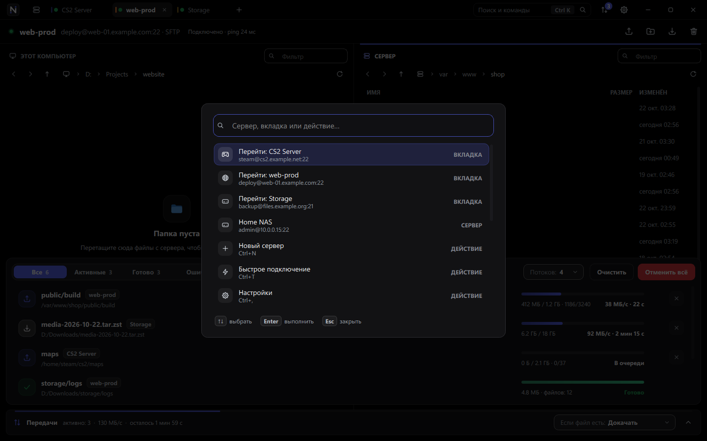
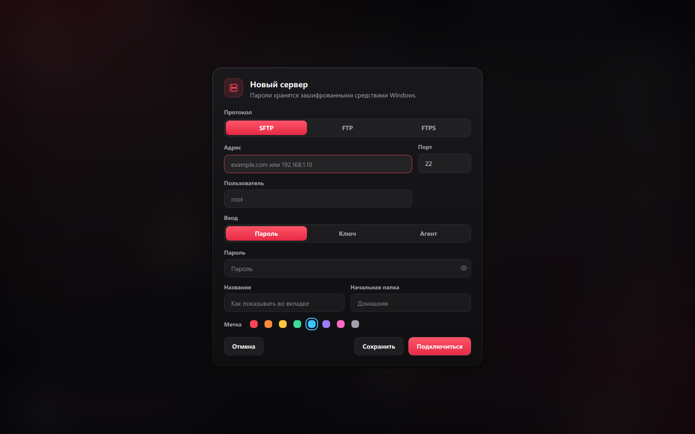
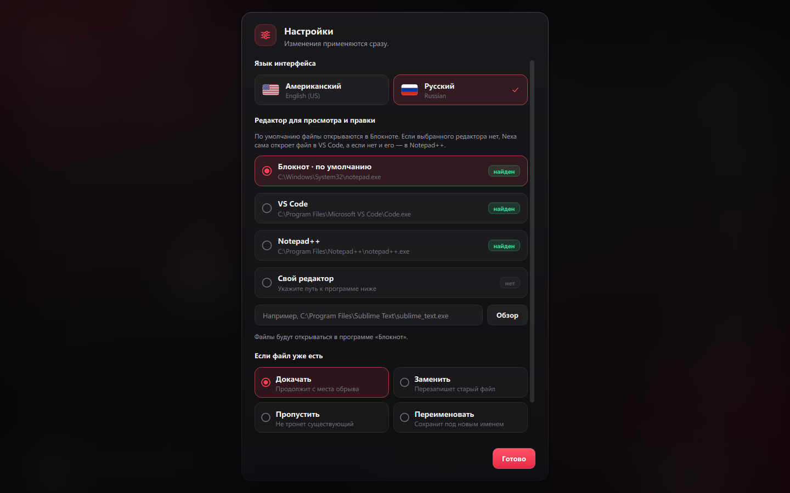

<p align="center">
  
</p>

<p align="center">
  <a href="README.md">English</a> · <strong>Русский</strong>
</p>

<p align="center">
  
  
  
  
  
</p>

<p align="center">
  <a href="#tour">Обзор</a> ·
  <a href="#performance">Скорость</a> ·
  <a href="#features">Возможности</a> ·
  <a href="#shortcuts">Клавиши</a> ·
  <a href="#build">Сборка</a> ·
  <a href="#roadmap">Планы</a>
</p>


**Nexa — быстрый SFTP-, FTP- и FTPS-клиент для Windows.** Каждый сервер
открывается в своей вкладке, передачи идут по нескольким соединениям
параллельно, а оборванная связь восстанавливается сама. Чёрный оникс, матовое
стекло, красный акцент — и никаких боковых панелей.

<table>
  <tr>
    <td width="50%" valign="top">
      <br>
      <strong>Быстро на реальных каналах</strong><br>
      До 64 файлов «в полёте» на соединение, 1–16 соединений на сервер.
      3000 мелких файлов загружаются за 4 секунды, а не за 11 минут.
    </td>
    <td width="50%" valign="top">
      <br>
      <strong>Много серверов сразу</strong><br>
      Вкладка на каждый сервер, у каждой свои соединения для просмотра и для
      передач.
    </td>
  </tr>
  <tr>
    <td width="50%" valign="top">
      <br>
      <strong>Без обрывов</strong><br>
      Простаивающая сессия пингуется, разорванная связь восстанавливается
      сколько угодно раз, прерванный файл докачивается с того байта, где
      остановился.
    </td>
    <td width="50%" valign="top">
      <br>
      <strong>Бросай куда угодно</strong><br>
      Перетащите файлы из Проводника — даже прямо из ZIP-архива — в любое место
      окна.
    </td>
  </tr>
  <tr>
    <td width="50%" valign="top">
      <br>
      <strong>Мгновенно</strong><br>
      Вкладка показывает папку сразу при открытии; подпапки и мелкие файлы
      подгружаются заранее, поэтому их открытие не ждёт сеть.
    </td>
    <td width="50%" valign="top">
      <br>
      <strong>Безопасно по умолчанию</strong><br>
      Пароли шифруются средствами Windows (DPAPI), ключи серверов и
      TLS-сертификаты проверяются по SHA-256-отпечатку.
    </td>
  </tr>
</table>

<a name="tour"></a>

##  Как это выглядит

> [!NOTE]
> На скриншотах выдуманные сервера и пустая локальная папка. Их снимает само
> приложение командой `Nexa.exe --demo-shots <папка>`: она работает с
> офлайн-сервером-заглушкой и временным профилем настроек.

### Сервера


На главной сохранённые сервера показаны карточками с цветной меткой,
протоколом и временем последнего подключения. Введите `user@host:22`,
`sftp://…` или `ftp://…` в быстрое подключение или откройте сервер одним
нажатием. Вкладки, открытые в прошлый раз, возвращаются сами — каждая в той
папке, где её оставили.

### Две панели, одно окно


Слева **этот компьютер**, справа **сервер**. В обеих панелях хлебные крошки,
«назад» и «вперёд», фильтр по имени и сортировка по столбцам. В шапке видны
сервер, протокол и живой пинг.

- Бросьте файлы в любое место окна, и они загрузятся в открытую папку сервера.
  Перетаскивайте между панелями или на другую вкладку, чтобы переключиться на
  неё.
- <kbd>F4</kbd> открывает файл с сервера в редакторе (по умолчанию Блокнот, если
  его нет — VS Code или Notepad++). Каждое сохранение сразу уходит на сервер, а
  уведомление показывает, сколько это заняло.
- <kbd>Delete</kbd> и <kbd>F2</kbd> работают в той панели, где фокус. Локальные
  файлы удаляются в Корзину и сразу пропадают из списка.

### Передачи


Одна очередь для всех серверов в панели внизу (<kbd>Ctrl</kbd> + <kbd>J</kbd>).
В каждой строке прогресс, число файлов, скорость и оставшееся время, есть повтор
и отмена. Большие файлы делятся на части, которые идут по нескольким
соединениям одновременно.

Что делать с файлами, которые **уже есть**, видно всегда: нижняя полоса
показывает текущее правило, а в открытой панели — четыре варианта и простое
пояснение к выбранному.

| Правило | Что делает |
|---|---|
| **Докачать** | Оборванный файл продолжится с места остановки, готовый пропустится |
| **Заменить** | Файл с тем же именем всегда перезаписывается |
| **Пропустить** | Файлы, которые уже есть, не трогаются |
| **Переименовать** | Новый файл сохраняется под другим именем, старый остаётся |

### Палитра команд



<kbd>Ctrl</kbd> + <kbd>K</kbd> находит любой сервер, вкладку или действие по
нескольким буквам.

### Новый сервер



SFTP, FTP или FTPS; пароль, приватный ключ или SSH-агент; название, начальная
папка и цветная метка. Пароли шифруются средствами Windows (DPAPI). Ключи
серверов и TLS-сертификаты проверяются по SHA-256-отпечатку.

### Настройки



<kbd>Ctrl</kbd> + <kbd>,</kbd> — язык интерфейса, редактор для просмотра и
правки, правило для существующих файлов и число параллельных соединений на
сервер.

> [!TIP]
> По умолчанию Nexa говорит на **американском английском**, по желанию — на
> **русском**: выберите флаг в настройках и нажмите «Перезапустить», открытые
> вкладки вернутся сами. То же из командной строки: `Nexa.exe --language ru`
> (или `en`).

<a name="performance"></a>

##  Скорость


Замеры на Windows 11 против OpenSSH 9.6 с добавленной задержкой (`tc netem`),
стенды — `tests/transfer_bench.cpp` и `tests/connect_bench.cpp`. При задержке
50 мс:

| Нагрузка | OpenSSH `scp` | Nexa, 1 соединение | Nexa, 4 соединения |
|---|---:|---:|---:|
| Загрузка 3000 мелких файлов (14 МБ) | 673 с · 4 файла/с | 9,4 с · 321 файл/с | **4,3 с · 696 файлов/с** |
| Загрузка одного файла 200 МБ | 24,7 МБ/с | **28,1 МБ/с** | 26,3 МБ/с |

При задержке 200 мс первый список папки приходит через 0,44 с после входа.
Сохранённый сервер показывает папку, где его оставили, сразу — ещё во время
подключения.

Каждая передача проверена побайтно, включая прогон, где соединение убивалось
посреди загрузки 200 МБ — Nexa переподключилась и докачала файл сама.

<a name="features"></a>

##  Возможности

<table>
  <tr>
    <td width="50%" valign="top">
      
      <strong>Сессии</strong>
      <ul>
        <li>SFTP поверх SSH, FTP и FTPS (явный <code>AUTH TLS</code>) рядом во вкладках</li>
        <li>Вход по паролю, приватному ключу, через SSH-агент и клавиатурный диалог</li>
        <li>После первого успешного входа сессия переподключается сколько угодно раз; передачи ждут связь, а не падают с ошибкой</li>
        <li>Живой пинг для каждой сессии</li>
      </ul>
    </td>
    <td width="50%" valign="top">
      
      <strong>Файлы</strong>
      <ul>
        <li>Свой конвейерный SFTP-клиент: списки, удаление и создание папок уходят пачками, а не по одному запросу</li>
        <li>Подпапки читаются заранее, поэтому открываются мгновенно</li>
        <li>Мелкий файл скачивается, как только его выделили, поэтому просмотр и правка открывают его без ожидания сети</li>
        <li>Перетаскивание из Проводника, из ZIP-архивов в Проводнике, между панелями и на вкладки</li>
        <li>Локальная папка отслеживается и обновляется сама</li>
      </ul>
    </td>
  </tr>
  <tr>
    <td width="50%" valign="top">
      
      <strong>Передачи</strong>
      <ul>
        <li>1–16 параллельных соединений на сервер; большие файлы делятся на части</li>
        <li>Докачать, заменить, пропустить или переименовать, если файл уже есть</li>
        <li>Скачивание идёт в файл <code>.nexapart</code> и переименовывается только после завершения</li>
        <li>Одно соединение для передач открывается заранее, поэтому первая передача начинается без входа</li>
      </ul>
    </td>
    <td width="50%" valign="top">
      
      <strong>Интерфейс</strong>
      <ul>
        <li>Свой заголовок окна со скруглёнными углами Windows 11, макетами Snap и изменением размера</li>
        <li>Матовые стеклянные меню, окна и уведомления поверх размытого фона</li>
        <li>Анимации с реальной частотой монитора (в том числе 144 Гц)</li>
        <li>Английский (США) и русский, переключаются в настройках</li>
      </ul>
    </td>
  </tr>
</table>

<a name="shortcuts"></a>

##  Горячие клавиши

| Сочетание | Действие |
|---|---|
| <kbd>Ctrl</kbd> + <kbd>K</kbd> | Палитра команд |
| <kbd>Ctrl</kbd> + <kbd>T</kbd> | Быстрое подключение |
| <kbd>Ctrl</kbd> + <kbd>N</kbd> | Новый сервер |
| <kbd>Ctrl</kbd> + <kbd>W</kbd> | Закрыть вкладку |
| <kbd>Ctrl</kbd> + <kbd>Tab</kbd> | Следующая вкладка |
| <kbd>Ctrl</kbd> + <kbd>J</kbd> | Показать или скрыть передачи |
| <kbd>Ctrl</kbd> + <kbd>,</kbd> | Настройки |
| <kbd>Ctrl</kbd> + <kbd>U</kbd> / <kbd>Ctrl</kbd> + <kbd>D</kbd> | Загрузить файлы / скачать выделенное |
| <kbd>Ctrl</kbd> + <kbd>Shift</kbd> + <kbd>N</kbd> | Новая папка на сервере |
| <kbd>F2</kbd> / <kbd>Delete</kbd> | Переименовать / удалить в панели с фокусом (локально — в Корзину) |
| <kbd>F4</kbd> | Просмотр / правка файла с сервера |
| <kbd>F5</kbd> | Обновить |
| <kbd>Ctrl</kbd> + <kbd>L</kbd> / <kbd>Ctrl</kbd> + <kbd>F</kbd> | Ввести путь / фильтр по имени |
| <kbd>Alt</kbd> + <kbd>←</kbd> / <kbd>→</kbd> | Назад и вперёд |
| <kbd>Backspace</kbd> | Родительская папка |

<a name="build"></a>

##  Сборка из исходников

Нужны Windows 10 или 11 x64, CMake 3.24+, Ninja, компилятор C++20,
Qt 6.6+ (`Core`, `Gui`, `Widgets`, `Network`), libssh 0.12+ и pkg-config.
Рекомендуемое окружение — MSYS2 UCRT64.

```powershell
cmake -S . -B build -G Ninja -DCMAKE_BUILD_TYPE=Release -DBUILD_TESTING=ON
cmake --build build --parallel
ctest --test-dir build --output-on-failure
.\scripts\build.ps1 -OutputDirectory dist-release
.\scripts\package.ps1 -Zip
```

`dist-release` — переносимая папка: запускается на любой Windows 10 или 11 x64
без MSYS2. `package.ps1` добавляет тексты лицензий всех поставляемых библиотек
и упаковывает `dist\Nexa-<версия>-windows-x64.zip`. При отправке тега `v*` то же
самое делает GitHub Actions и создаёт черновик релиза с архивом и его SHA-256.

<details>
<summary><strong>Как пересоздать скриншоты и оформление</strong></summary>

<br>

Скриншоты — русские для этого файла, английские для [README.md](README.md):

```powershell
.\build\Nexa.exe --demo-shots docs\assets\ru --language ru
```

```powershell
.\build\Nexa.exe --demo-shots docs\assets
```

Баннер, цифры, иконки разделов и шапки документов в `docs/assets/brand`
нарисованы по цветам темы и формам иконок самого приложения
(`src/ui/theme.h`, `src/ui/icons.cpp`). После правки текстов в скрипте
пересоздайте их:

```powershell
node scripts\brand-assets.mjs
```

</details>

<details>
<summary><strong>Структура проекта</strong></summary>

<br>

```text
src/core   протоколы (свой конвейерный SFTP-клиент, FTP/FTPS), сессии,
           движок передач, сохранённые сервера, кэш папок
src/ui     окно, вкладки, панели, панель передач, окна, иконки, тема и
           демо для скриншотов
tests      модульные тесты, замеры передач и подключения
docs       скриншоты и оформление README на английском и русском
scripts    сборка переносимой папки и генерация оформления
```

</details>

<a name="roadmap"></a>

##  Планы

- [x] Несколько серверов одновременно во вкладках
- [x] Параллельные и сегментированные передачи
- [x] Автоматическое переподключение и докачка
- [x] Просмотр и правка с автоматической загрузкой
- [ ] SSH-терминал во вкладке
- [ ] Очередь, которая переживает перезапуск
- [ ] Проброс портов и jump-хосты
- [ ] Установщик для Windows и автообновления

Что и когда менялось: [CHANGELOG.ru.md](CHANGELOG.ru.md) · [VERSION.ru.md](VERSION.ru.md).

##  Безопасность

> [!WARNING]
> Не публикуйте в открытых issue пароли, приватные ключи, адреса серверов и
> чувствительные логи. Об уязвимостях сообщайте закрыто — см.
> [SECURITY.ru.md](SECURITY.ru.md).

**Конфиденциальность.** Nexa подключается только к серверам, которые вы
добавили, не собирает телеметрию и ничего не проверяет в фоне. Архивы выпусков
собирает [GitHub Actions](.github/workflows/windows.yml) из этого репозитория.

##  Лицензия

Nexa распространяется по
[GNU General Public License v3.0 или новее](LICENSE). Qt и libssh подключаются
динамически и остаются под своими лицензиями; см.
[THIRD_PARTY_NOTICES.ru.md](THIRD_PARTY_NOTICES.ru.md).


<p align="center">
  <br>
  <sub>
    <a href="CONTRIBUTING.ru.md">Участие в разработке</a> ·
    <a href="CODE_OF_CONDUCT.ru.md">Правила сообщества</a> ·
    <a href="SECURITY.ru.md">Безопасность</a> ·
    <a href="THIRD_PARTY_NOTICES.ru.md">Сторонние компоненты</a>
  </sub>
</p>
