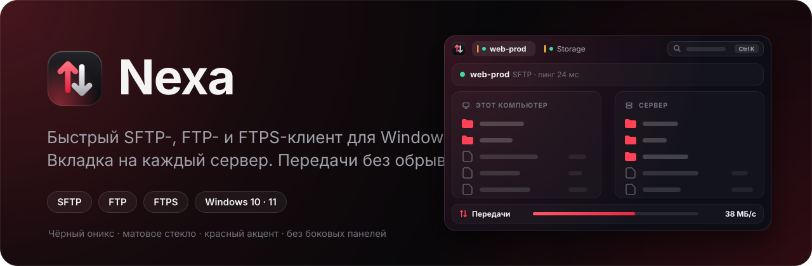
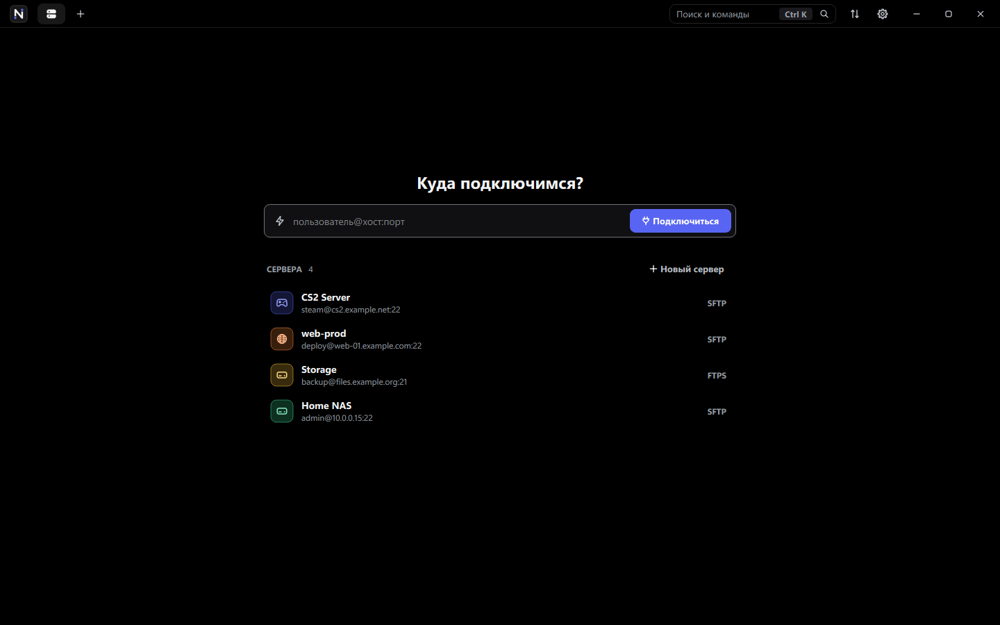
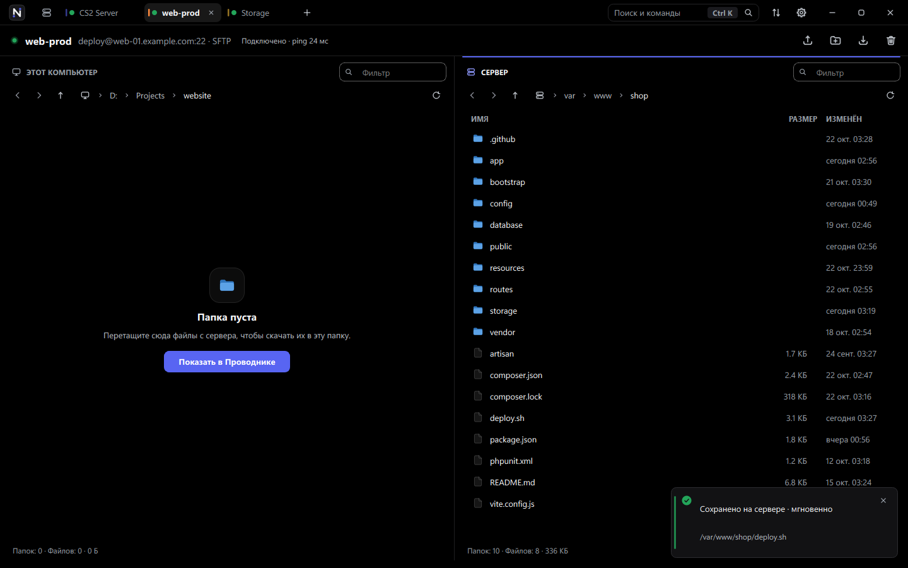
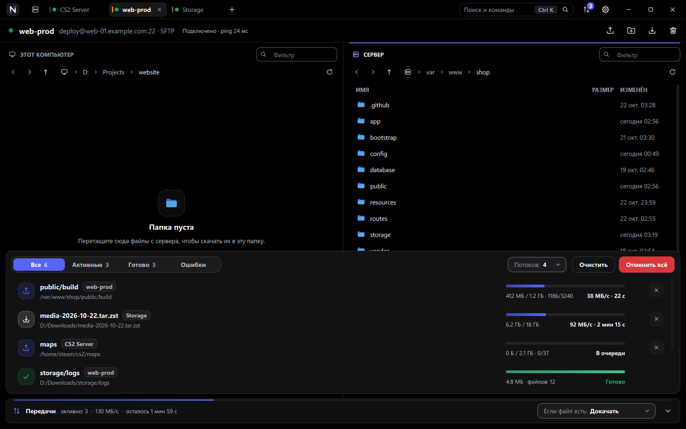
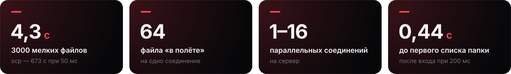

<p align="center">
  
</p>

<p align="center">
  <a href="README.md">English</a> · <strong>Русский</strong> · <a href="README.de.md">Deutsch</a>
</p>

<p align="center">
  <a href="https://github.com/whyn0tq/Nexa/releases/latest"></a>
  
  
</p>


**Nexa — быстрый клиент SFTP, FTP и FTPS для Windows.** Каждый сервер
открывается в своей вкладке. Файлы идут в несколько потоков сразу, а если связь
пропала, Nexa подключается заново и докачивает файл сама.

- **Быстро.** 3000 мелких файлов уходят на сервер за 4 секунды. `scp` на том же
  канале делает это за 11 минут.
- **Много серверов.** Одна вкладка — один сервер.
- **Без обрывов.** Связь пропала — Nexa переподключится, файл продолжится с
  того места, где остановился.
- **Перетаскивание.** Тащите файлы из Проводника, даже из ZIP, прямо в окно.
- **Безопасно.** Пароли шифрует Windows (DPAPI). Ключи серверов и сертификаты
  проверяются по отпечатку SHA-256.

## Установка

1. Скачайте `Nexa-<версия>-windows-x64.zip` со
   [страницы релизов](https://github.com/whyn0tq/Nexa/releases/latest).
2. Распакуйте архив и запустите `Nexa.exe`. Устанавливать ничего не нужно.

## Как пользоваться



Впишите адрес в строку быстрого подключения (`Ctrl` + `T`) или нажмите на
сохранённый сервер. Подойдёт любой из этих видов:

```text
deploy@example.com:22
sftp://deploy@example.com
ftp://user@files.example.org:21
```

Чтобы сохранить сервер, нажмите `Ctrl` + `N`. Там же выбирается протокол: SFTP,
FTP или FTPS.



Слева ваш компьютер, справа сервер. Перетащите файлы в окно, и они загрузятся в
открытую папку на сервере. `F4` открывает файл с сервера в редакторе: каждое
сохранение сразу уходит обратно.



Все передачи собраны в панели внизу (`Ctrl` + `J`). Если файл с таким именем
уже есть, Nexa поступит по выбранному правилу:

| Правило | Что произойдёт |
|---|---|
| **Докачать** | Недокачанный файл продолжится, готовый пропустится |
| **Заменить** | Файл всегда перезапишется |
| **Пропустить** | Существующие файлы не тронутся |
| **Переименовать** | Новый файл получит другое имя, старый останется |

Интерфейс на английском, русском и немецком. Язык выбирается в настройках
(`Ctrl` + `,`) или при запуске:

```powershell
Nexa.exe --language ru
```

## Горячие клавиши

| Клавиши | Действие |
|---|---|
| `Ctrl` + `K` | Поиск и команды |
| `Ctrl` + `T` | Быстрое подключение |
| `Ctrl` + `N` | Новый сервер |
| `Ctrl` + `W` | Закрыть вкладку |
| `Ctrl` + `Tab` | Следующая вкладка |
| `Ctrl` + `J` | Показать или скрыть передачи |
| `Ctrl` + `,` | Настройки |
| `Ctrl` + `U` / `Ctrl` + `D` | Загрузить / скачать выделенное |
| `Ctrl` + `Shift` + `N` | Новая папка на сервере |
| `F2` / `Delete` | Переименовать / удалить |
| `F4` | Открыть файл с сервера в редакторе |
| `F5` | Обновить |
| `Ctrl` + `L` / `Ctrl` + `F` | Ввести путь / фильтр по имени |
| `Alt` + `←` / `→` | Назад и вперёд |
| `Backspace` | Папка выше |

## Скорость



Замеры на Windows 11 против OpenSSH 9.6 при задержке канала 50 мс:

| Что грузим | `scp` | Nexa, 1 соединение | Nexa, 4 соединения |
|---|---:|---:|---:|
| 3000 мелких файлов (14 МБ) | 673 с | 9,4 с | **4,3 с** |
| Один файл 200 МБ | 24,7 МБ/с | **28,1 МБ/с** | 26,3 МБ/с |

Стенды лежат в `tests/transfer_bench.cpp` и `tests/connect_bench.cpp`. Каждая
передача сверена побайтно, в том числе с обрывом связи посреди загрузки.

## Сборка из исходников

Нужны Windows 10 или 11 x64, CMake 3.24+, Ninja, компилятор C++20, Qt 6.6+,
libssh 0.12+ и pkg-config. Проще всего собирать в MSYS2 UCRT64.

```powershell
cmake -S . -B build -G Ninja -DCMAKE_BUILD_TYPE=Release -DBUILD_TESTING=ON
cmake --build build --parallel
ctest --test-dir build --output-on-failure
.\scripts\build.ps1 -OutputDirectory dist-release
.\scripts\package.ps1 -Zip
```

Архив появится в `dist\`. Он запускается на любой Windows 10 или 11 без MSYS2.
При отправке тега `v*` то же делает GitHub Actions и создаёт черновик релиза.

## Планы

- [x] Несколько серверов во вкладках
- [x] Параллельные передачи и докачка
- [x] Открытие и правка файлов с сервера
- [ ] SSH-терминал во вкладке
- [ ] Очередь передач, которая переживает перезапуск
- [ ] Проброс портов и jump-хосты
- [ ] Установщик и автообновление

## Безопасность и лицензия

Nexa подключается только к серверам, которые вы добавили, не собирает
телеметрию и ничего не проверяет в фоне. О найденных уязвимостях сообщайте
закрыто, как описано в [SECURITY.ru.md](SECURITY.ru.md).

Лицензия — [GPL-3.0 или новее](LICENSE). Qt и libssh подключаются как
библиотеки и остаются под своими лицензиями, подробнее в
[THIRD_PARTY_NOTICES.ru.md](THIRD_PARTY_NOTICES.ru.md).


<p align="center">
  <br>
  <sub>
    <a href="CHANGELOG.ru.md">История изменений</a> ·
    <a href="CONTRIBUTING.ru.md">Участие</a> ·
    <a href="CODE_OF_CONDUCT.ru.md">Правила сообщества</a>
  </sub>
</p>
